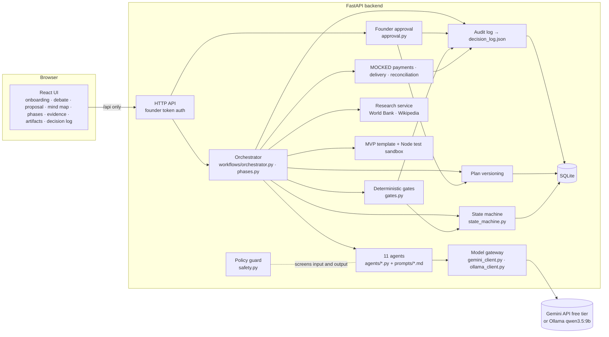
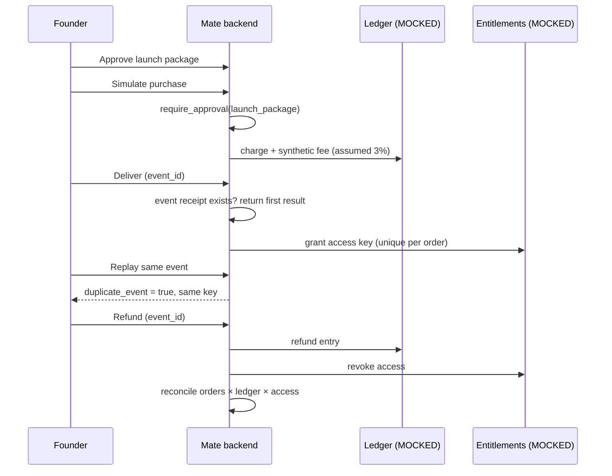
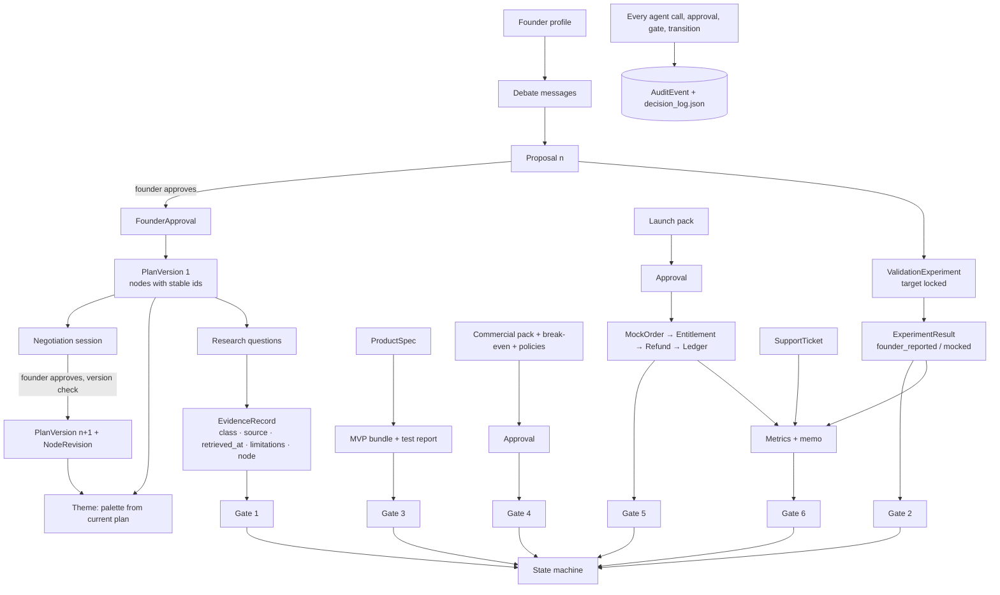

# Architecture

## Overview

Mate is a FastAPI backend with a React frontend. The backend runs eleven agents over one model gateway
(Gemini API free tier by default, or a local open-weight model through Ollama), a 14-state venture state machine, deterministic phase gates, a founder-approval
module, a research service and MOCKED commerce services. Agents only return typed data. Approving, changing the plan,
passing a gate, publishing or "selling" can only happen through code paths that check founder approval and recorded
evidence. Every agent action, approval, gate and state change is written to the database and to `decision_log.json`.

Key boundaries:

- **The browser never talks to the model.** Nginx proxies `/api` to the backend. The Gemini key stays in the backend's
  environment; Ollama, when used, is reachable only inside the Compose network.
- **Agents cannot act.** `agents/base.py` gives an agent a model gateway and an audit logger. It has no access to
  `approval.record_decision`, `plan_versioning.commit_revision` or state transitions.
- **Gates are code.** The Gatekeeper agent receives the decided outcome and can only explain it; its output schema
  has no outcome field.
- **No silent fallback.** A live venture whose model is down returns an `agent_failure` error and the step does not
  advance. Scripted demo ventures are chosen explicitly and labelled everywhere.

## Phases

Each phase runs while the venture is in its state, and ends with a gate. Agent outputs become artifacts
(`GET /api/ventures/{id}/artifacts`) and the demo run's copies are in `outputs/`.

### Phase 1 — Discover (core step: find opportunities)

- **Agents:** Founder Discovery (profile analysis), Skeptical Co-Founder (debate, proposals), Opportunity Evaluation
  (comparison), Market Research (research questions), Validation (Mom Test interview plan), Gatekeeper.
- **Tools:** founder profile and conversation (read), research service (World Bank Indicators API, Wikipedia REST API),
  policy guard.
- **Method:**
  1. Onboarding stores a structured founder profile (background, resources, preferences). The Founder Discovery agent
     turns it into strengths, limits, constraints and open questions that every later agent receives.
  2. The debate: each founder message is screened by the policy guard first (excluded categories, fake reviews,
     override attempts — refused without a model call). Otherwise the Skeptical Co-Founder replies with a stance,
     one key question, classified assumptions, alternatives and a six-item readiness checklist.
  3. On request, the Opportunity Evaluation agent scores 2–3 directions on 12 criteria (1–5, rationale and evidence
     class each). Code computes a weighted 0–100 index with published weights and a budget check. It is labelled a
     heuristic, not a probability.
  4. The founder asks for a proposal at any time. The proposal lists problem, customer, solution, fit, value
     proposition, model, revenue streams, expenses (each an ASSUMPTION with basis and currency), alternatives, risks,
     missing evidence, a first experiment with a declared target, reasons for and against, and Mate's recommendation
     (which can be DO_NOT_PROCEED).
  5. Reject → back to the debate with the reason recorded. Approve → founder approval row, plan v1 built from the
     proposal (stable node ids), workspace opens.
  6. Phase 1 run: the Market Research agent writes research questions with indicator hints and names alternatives;
     the research service retrieves what it can, stores source URL, retrieval date, limitations and implication, and
     records the rest as UNKNOWN. The Validation agent writes the Mom Test interview plan (questions only — Mate never
     generates interview answers).
- **Output:** founder profile, debate transcript, opportunity comparison, proposals, evidence register, interview plan,
  gate decision.

### Phase 2 — Validate (core step: design the business)

- **Agents:** Validation, Gatekeeper.
- **Tools:** plan and evidence register (read).
- **Method:** Lean Canvas (all entries ASSUMPTION), riskiest assumptions linked to plan nodes (stored as hypotheses),
  landing-page copy for a waitlist or pilot-request test rendered as a local draft page (never published), and
  experiments. The proposal's first experiment plus at most two extras are stored with targets and windows and
  **locked** before any result exists; re-running the phase never changes them. Results are entered by the founder
  (`founder_reported`) — or, in demo ventures only, as `mocked`.
- **Output:** Lean Canvas, landing page draft, experiment register, gate decision.

### Phase 3 — Build (core step: build the product)

- **Agents:** Product Architect (spec), MVP Builder (copy), Gatekeeper.
- **Tools:** reviewed template for one product class (offline single-page records tool), Node.js test runner.
- **Method:** the Product Architect maps must-have features to supported capabilities (create/edit/delete, search,
  status workflow, filters, due dates, summary counts, CSV/JSON export, local persistence); anything else goes to
  out-of-scope and is labelled STUBBED in the README it generates. The MVP Builder writes only copy. Code is rendered
  from templates (`services/mvp_template.py`), tests are generated from the spec, and `node --test` runs with a fixed
  argv, a timeout, a minimal environment and a temporary directory. No model-generated command is ever executed.
- **Output:** product spec, MVP bundle (downloadable zip; sandboxed preview), test report, user guide, gate decision.

### Phase 4 — Commercial setup (core step: set the price and policies)

- **Agents:** Commercial, Gatekeeper.
- **Tools:** plan and product spec (read), break-even calculator (`services/finance.py`).
- **Method:** pricing follows the plan's revenue model (in the demo, the per-term billing the founder negotiated).
  Every cost is an explicit assumption (fixed monthly, one-time or per sale). Break-even and customer scenarios are
  computed in code and labelled PROJECTION. Terms, privacy and refund policies are rendered from templates with the
  agent's specifics and stamped "DRAFT — not legal advice". A compliance checklist lists what needs a lawyer. The
  founder must approve the commercial setup. No payment integration of any kind exists.
- **Output:** pricing and break-even, draft policies, compliance checklist, gate decision.

### Phase 5 — Launch (core steps: open the store; deliver automatically — MOCKED)

- **Agents:** Launch, Gatekeeper.
- **Tools:** MOCKED payments, delivery and reconciliation services; external-action guard.
- **Method:** the Launch agent drafts the store page, announcements in the founder's voice, a delivery message and a
  launch checklist; the policy guard screens them for fake reviews, urgency and income claims. After founder approval,
  the founder can run the MOCKED sale-to-cash cycle (below). Publishing an announcement needs a separate approval and
  still is not executed — no connector exists.
- **Output:** store page (MOCKED), launch package, payment test log, gate decision.

### Phase 6 — Operate and learn

- **Agents:** Operations, Gatekeeper.
- **Tools:** metrics (experiments, MOCKED orders, refunds, support tickets), support triage.
- **Method:** support requests are categorised and get a draft reply the founder sends personally. The Operations
  agent writes a persevere-or-pivot memo that must say when data is MOCKED or missing. The memo is advisory; the
  gate decides.
- **Output:** support triage, metrics snapshot, memo, gate decision.

## Gates

Gates live in `backend/app/workflows/gates.py`. Each returns GO, REPEAT, PIVOT or STOP with a list of checks
(passed, detail, severity) and an evidence basis (`founder_reported`, `mocked`, `test_results`, …). Any failed
**hard-policy** check means STOP regardless of anything else. GO moves the venture to the next phase state; REPEAT
keeps it; PIVOT moves it to `PIVOT_REQUIRED`; STOP moves it to `STOPPED`. Reopening a stopped venture returns to the
debate but never changes past gate results or evidence classes.

| Gate | What it checks | Outcomes |
|---|---|---|
| 1 Discover | Approved proposal; allowed category (hard); heuristic fit ≥ 3/5; start-up capital ≤ 3× budget; Mate's own recommendation; declared first experiment; research and interview plan done | STOP if capital is far beyond budget **and** (fit < 3 **or** Mate advised against); PIVOT if one of those fails; REPEAT if work is missing; else GO |
| 2 Validate | Validation pack exists; targets locked before results; each experiment's latest recorded result vs its target | GO if all recorded ≥ 100%; REPEAT if worst ≥ 50% or the primary result is missing ("pending"); PIVOT if 25–50%; **STOP below 25%** |
| 3 Build | Spec; required files; tests executed; all tests pass with exit code 0; every feature in scope | GO or REPEAT |
| 4 Commercial | Pack exists; price covers variable cost; three policies drafted and labelled; no unsafe claims (hard); no payments (hard); founder approval | STOP on hard failure; PIVOT if unit economics are negative; REPEAT until approved; else GO |
| 5 Launch | Pack; no unsafe launch copy (hard); no payment-provider credentials in the environment (hard); founder approval; MOCKED delivery happened; MOCKED refund revoked access; replayed event created no second entitlement; ledger reconciles | STOP on hard failure; REPEAT until complete; else GO |
| 6 Operate | Memo; experiment results; results vs target; refund rate ≤ 30% (3+ orders); real (non-MOCKED) data present (advisory) | STOP below 25% of target; PIVOT below target or high refunds; REPEAT without data; GO = continue. In live ventures, MOCKED-only data cannot produce GO |

**STOP on weak evidence.** The problem statement's example — a target of 100 sign-ups in 14 days and 12 recorded —
is 12% of target, so Gate 2 returns STOP and the log reads "12 of 100 … Target missed" (see `tests/test_gates.py`).
The committed demo also includes a weak idea stopped at Gate 1 (`outputs/phase1_gate_weak-idea-stop.md`): a free
general-purpose AI chat app needing an assumed 150× the founder's budget, fit 2/5, with Mate advising against it.

**Founder approval vs. gates.** The founder can reject anything and can reopen a stopped venture, but cannot relabel
evidence, change a recorded gate outcome or override a hard policy rule. A favourable model answer cannot either
(`test_favourable_model_commentary_cannot_change_a_failed_gate`).

## Sale to cash

Everything in this section is **MOCKED** in this submission. There is no payment provider, no sandbox, no card or
bank data, and no money. The diagram shows the cycle that runs today; the production design is described after it.

- **Payment triggers delivery.** A mock-paid order is the only state that can be delivered (`mock_delivery.deliver`).
- **A refund revokes access.** `mock_payments.refund_mock_order` writes the refund entry and revokes the entitlement.
- **Idempotency prevents double delivery.** Every delivery or refund carries an `event_id`; processed ids are stored
  in `mock_event_receipts` and replayed events return the first result. A unique constraint allows one entitlement per order.
- **Reconciliation** (`mock_reconcile.py`) matches each order's charge, synthetic fee, refund, mock payout and access
  state, and reports mismatches; the Launch gate requires it to balance.
- **Future production design (not built):** a payment provider's webhook would replace the "simulate purchase" call and
  feed the same idempotent delivery path; payouts would be reconciled against provider reports. This would require
  legal review, founder-owned accounts and an explicit approval step, and it is out of scope for this hackathon.
- The Launch gate STOPs if payment-provider credentials (e.g. `STRIPE_*`) are present in the environment.

## Data flow

Storage is SQLite via SQLAlchemy (`backend/app/models/entities.py`). Documents that are naturally structured
(profile, proposal, plan version) are validated JSON inside relational rows; anything that is approved, gated or
audited has its own table. Plan versions are immutable; `GET /plan?version=n` returns any past version and
`GET /export` returns a JSON export of the venture.

**Model gateway.** `MODEL_PROVIDER` selects `GeminiGateway` (default) or `OllamaGateway`; both implement
`generate_structured`. It sends the agent's system prompt, the context it is allowed to see and the Pydantic JSON schema
(Gemini `responseJsonSchema`, falling back to JSON mode with the schema in the prompt; Ollama `format`). Gemini 429
responses wait for the suggested retry delay a limited number of times. Replies are parsed, validated, and retried with the validation
error (default two retries). Timeouts, unreachable servers, missing models, missing or rejected keys and exhausted quota raise `ModelUnavailableError`;
persistent malformed output raises `ModelOutputError`; both become an `agent_failure` response and a failed
`AgentRun`, never a fabricated success. Token counts reported by the provider are logged per call.

**Policy guard.** `services/safety.py` screens founder messages before any model call, screens and redacts model
output (income promises, urgency, testimonials), screens generated copy before it can be approved, and sanitises
retrieved text (instruction-like content removed, wrapped as untrusted data).

**Adaptive palette.** `services/theme_service.py` classifies the current plan (or proposal, or the discussion before a
proposal exists) into a system archetype with keyword matching, generates tokens in OKLCH and darkens them until
every pair meets its WCAG target. Economic and evidence colours never change between palettes; a stopped or pivoting
venture is muted. Details: `docs/design/adaptive-palettes.md`.

## Built vs. stubbed

| Area | Built | Stubbed or mocked |
|---|---|---|
| Agents | 11 agents with prompts, schemas, tools, logging | — |
| Model | Gemini API and Ollama gateways with structured output, retries, timeouts, rate-limit handling, status checks | Streaming (Ollama only) not used by the UI |
| Discover | Debate, comparison, proposals, approval, research, interview plan, gate | Research limited to two free APIs; offline runs are degraded and labelled |
| Validate | Lean Canvas, hypotheses, locked experiments, results entry, gate | Landing page is a local draft; no hosting, no real sign-up capture |
| Build | One product class, generated tests, sandboxed run, zip export | Other product classes |
| Commercial | Pricing, break-even, draft policies, checklist, approval | Legal review is a human task |
| Launch | Drafts, approval, MOCKED order/delivery/refund/reconciliation, publishing guard | **MOCKED**: payments and delivery. **STUBBED**: publishing connectors |
| Operate | Support triage, metrics, memo, gate | Demo metrics are MOCKED |
| Platform | State machine, approvals, versioning, audit log, adaptive palette, Docker Compose | Single-user token auth; `create_all` instead of migrations |

## Roadmap

1. Run and publish a live-model demo log alongside the scripted one; add evals that score live debate behaviour.
2. More research connectors (official statistics portals, app-store listings) behind the same evidence rules.
3. Additional MVP product classes (booking pages, content libraries) with their own templates and generated tests.
4. Alembic migrations, multi-user workspaces and proper accounts.
5. Arabic interface and right-to-left mind map.
6. Optional founder-owned publishing connectors that reuse the existing approval guard, still with no payments
   unless a separate, legally reviewed design is approved.
